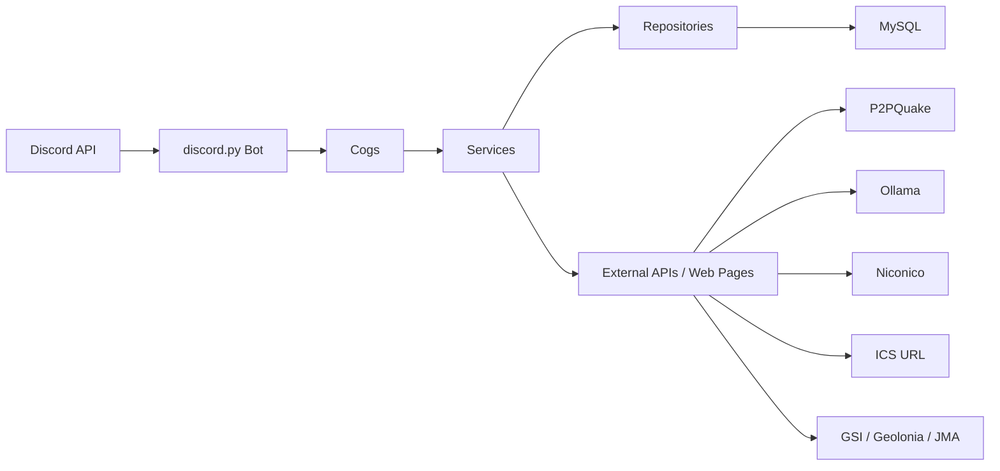

# システム構成

## 概要

本システムは `discord.py` を利用した Discord Bot である。Discord イベントとコマンドを Cog で受け付け、Service 層で業務処理を行い、Repository 層を通じて MySQL に永続化する。

## アプリケーション構成

| 層 | 役割 | 主な配置 |
|---|---|---|
| エントリポイント | Bot 初期化、DB 初期化、Cog 登録、起動制御 | `main.py` |
| Cog | Discord イベント・コマンド受付 | `cogs/` |
| Service | 業務処理、外部 API 連携、通知本文生成 | `services/` |
| Repository | DB アクセス処理 | `repositories/` |
| Model | SQLAlchemy ORM モデル | `models/` |
| DB | ログ、設定、通知状態、同期状態の永続化 | MySQL |
| 設定 | 環境変数読み込み、機能フラグ、外部 URL | `config.py`, `constants.py` |

## 機能構成

| 機能 | Cog | Service | 主なテーブル |
|---|---|---|---|
| メッセージログ | `MessageCog` | `MessageLogService` | `message_log`, `message_edit_log`, `message_delete_log` |
| ボイス状態ログ | `VoiceCog` | `VoiceChannelStatusService` | `voice_status_log` |
| リアクション自動化 | `MessageReactionCog` | `MessageReactionService` | `b_reaction_keywords` |
| ダイスロール | `DiceRollCog` | `DiceRollService` | なし |
| リアクション抽選 | `ReactionLotteryCog` | `ReactionLotteryService` | なし |
| Ollama メッセージ分析 | `MessageWatcherCog` | `MessageWatcherService` | `message_analysis_log` |
| P2PQuake 通知 | `P2PQuakeCog` | `P2PQuakeService` | `b_notify_cannel_config`, `b_jma_shindo_station`, `b_geolonia_address` |
| ICS 予定イベント | `IcsGuildEventCog` | `IcsGuildEventService` | `ics_guild_event_config`, `ics_guild_event_import` |
| コミュニケーション傾向分析 | `CommunicationTrendCog` | `CommunicationTrendService` | `communication_trend_analysis` |
| Niconico Info | `NiconicoInfoCog` | `NiconicoInfoService` | `niconico_info_event`, `niconico_info_filter` |
| Niconico ユーザー投稿 | `NiconicoUserVideoCog` | `NiconicoUserVideoService` | `b_m_niconico_video_infomation`, `b_niconico_notify_cannel_config`, `b_niconico_video_send_log` |
