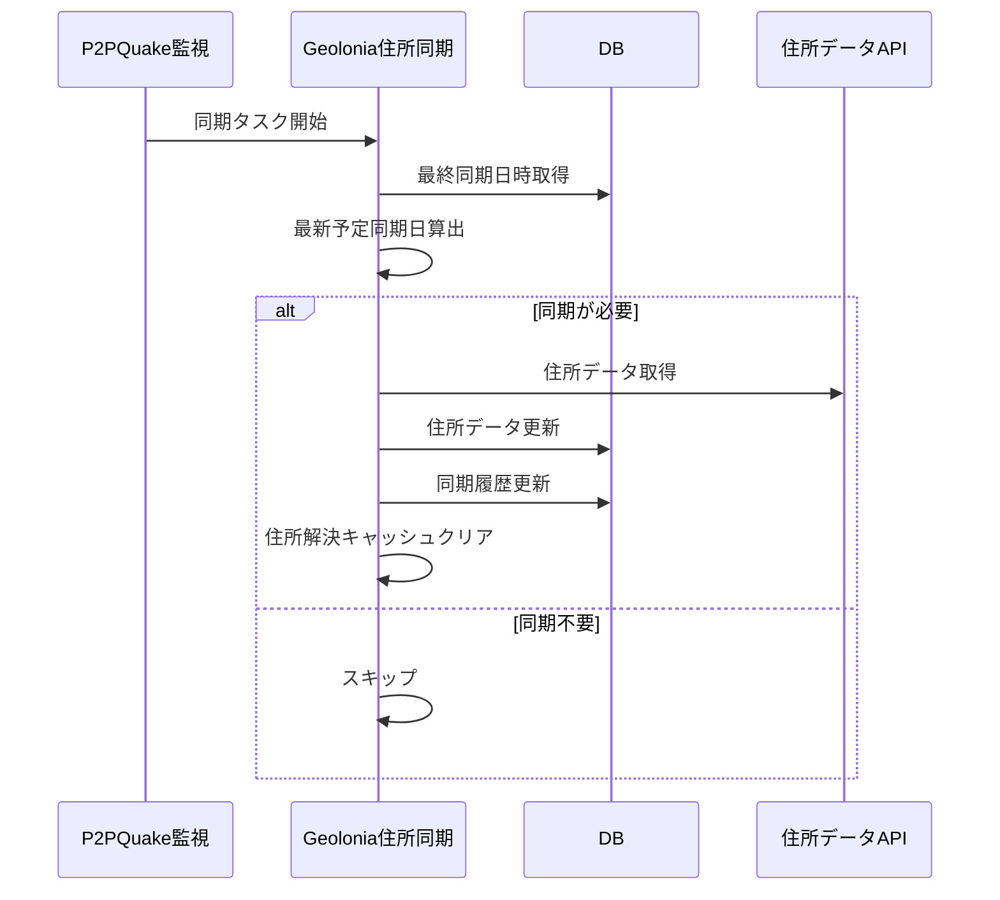

# Geolonia 住所同期設計

## 1. 概要

P2PQuake 通知の観測点座標解決で利用する住所データを、Bot 起動後のバックグラウンド処理で同期する。
同期履歴に基づいて必要な場合のみ更新し、更新後は住所解決キャッシュをクリアする。

## 2. 構成

| 構成要素 | 役割 |
|---|---|
| 同期タスク | Bot 稼働中に定期的に同期要否を確認する。 |
| 同期履歴 | 最終同期日時を保持し、同期要否判定に利用する。 |
| 住所データ | 都道府県、市区町村、町域、緯度、経度を保持する。 |
| 住所解決キャッシュ | P2PQuake 通知で利用する住所検索結果を保持する。 |

## 3. 同期方針

| 項目 | 方針 |
|---|---|
| 有効化 | 設定で同期を有効化した場合のみ実行する。 |
| 初回同期 | 同期履歴がない場合は住所データを登録する。 |
| 定期同期 | 最新予定同期日より最終同期日時が古い場合に更新する。 |
| スキップ | 最終同期日時が最新予定同期日以降の場合は更新しない。 |
| キャッシュ | 同期完了後に住所解決キャッシュをクリアする。 |

## 4. 予定同期日

毎年 1 月 1 日と 6 月 1 日を予定同期日として扱う。
現在日時から見た最新の予定同期日を基準に、同期が必要か判定する。

## 5. 利用データ

| データ | 用途 |
|---|---|
| 都道府県 | 住所階層の上位分類 |
| 市区町村 | 観測点名からの所在地解決 |
| 町域 | 地点名の詳細解決 |
| 緯度 | 地図描画・地点解決 |
| 経度 | 地図描画・地点解決 |

## 6. 処理フロー

## 7. 関連要件

- FR-GEO-001 から FR-GEO-008
- FR-QUAKE-011
