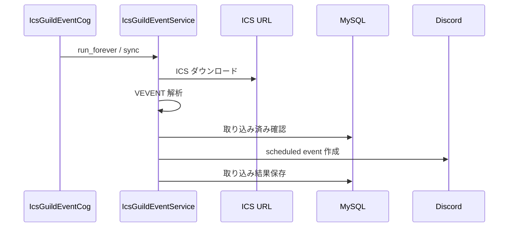

# ICS 予定イベント取り込み設計

## 概要

ICS カレンダーから予定を取得し、Discord scheduled event として登録する。

## 構成

| 項目 | 内容 |
|---|---|
| Cog | `IcsGuildEventCog` |
| Service | `IcsGuildEventService` |
| Repository | `IcsGuildEventConfigRepository`, `IcsGuildEventImportRepository`, `NotifyChannelConfigRepository` |
| テーブル | `ics_guild_event_config`, `ics_guild_event_import`, `b_notify_cannel_config` |

## コマンド

| コマンド | 内容 |
|---|---|
| `ics_event_enable` | ギルドの ICS 取り込みを有効化する。 |
| `ics_event_disable` | ギルドの ICS 取り込みを無効化する。 |
| `ics_event_status` | 有効状態を表示する。 |
| `ics_event_sync` | 手動同期を実行する。 |

## 処理フロー

