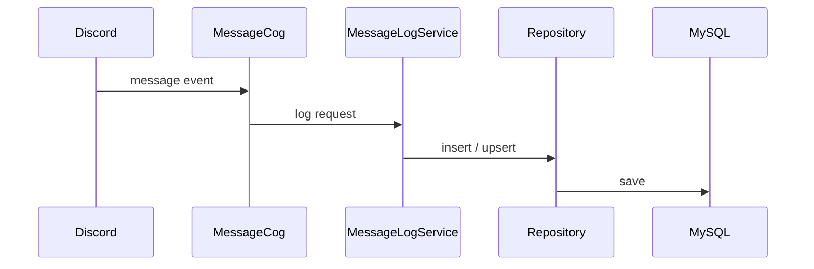

# メッセージログ設計

## 概要

Discord のメッセージ投稿、編集、削除を記録する。管理者は過去メッセージのバックフィルを実行できる。

## 構成

| 項目 | 内容 |
|---|---|
| Cog | `MessageCog` |
| Service | `MessageLogService` |
| Repository | `MessageLogRepository`, `MessageEditLogRepository`, `MessageDeleteLogRepository`, `DiscordUserRepository`, `DiscordChannelRepository` |
| テーブル | `message_log`, `message_edit_log`, `message_delete_log`, `discord_user`, `discord_channel` |

## コマンド・イベント

| 種別 | 名前 | 内容 |
|---|---|---|
| Event | `on_message` | 投稿メッセージを保存する。 |
| Event | `on_message_edit`, `on_raw_message_edit` | 編集ログを保存する。 |
| Event | `on_message_delete`, `on_raw_message_delete` | 削除ログを保存する。 |
| Command | `backfill_message_logs` | 過去メッセージを取り込む。 |

投稿メッセージ保存と履歴取り込みでは、投稿者の表示名・Bot 判定・avatar URL と、投稿チャンネルの名前・種別・親チャンネル情報を最新マスタとして upsert する。

## 処理フロー

