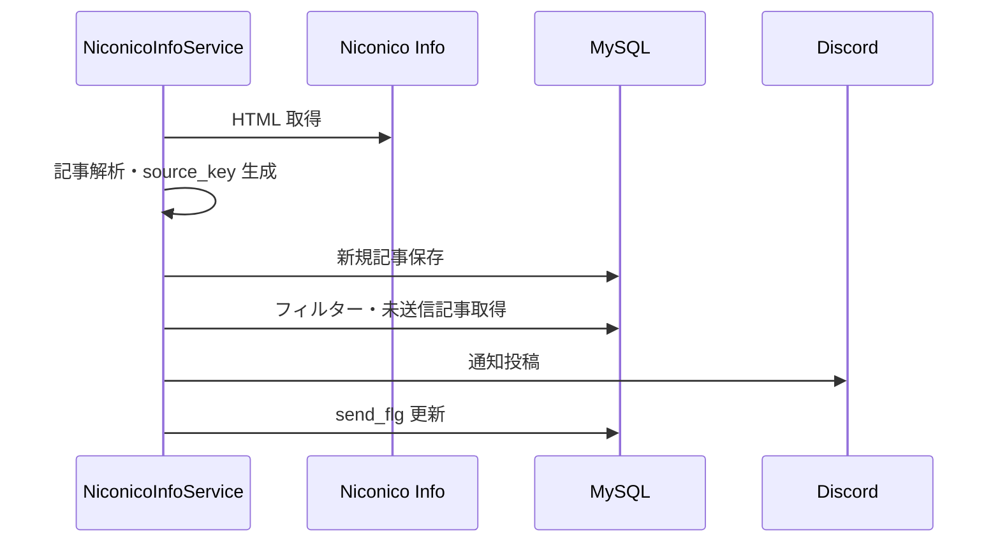

# Niconico Info 通知設計

## 概要

Niconico Info / niconews カテゴリページから記事を検出し、条件に一致する未送信記事を Discord へ通知する。

## 構成

| 項目 | 内容 |
|---|---|
| Cog | `NiconicoInfoCog` |
| Service | `NiconicoInfoService` |
| Repository | `NiconicoInfoEventRepository`, `NiconicoInfoFilterRepository`, `NotifyChannelConfigRepository` |
| テーブル | `niconico_info_event`, `niconico_info_filter`, `b_notify_cannel_config` |

## コマンド

| コマンド | 内容 |
|---|---|
| `niconico_info_check` | 手動で Niconico Info を確認する。 |
| `niconico_info_filter add/list/enable/disable/remove` | include / exclude フィルターを管理する。 |

## 処理フロー

